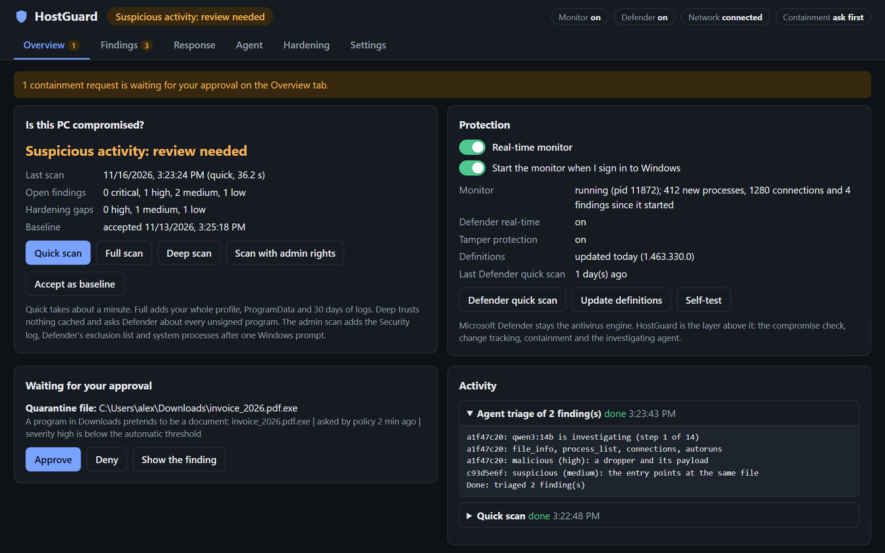
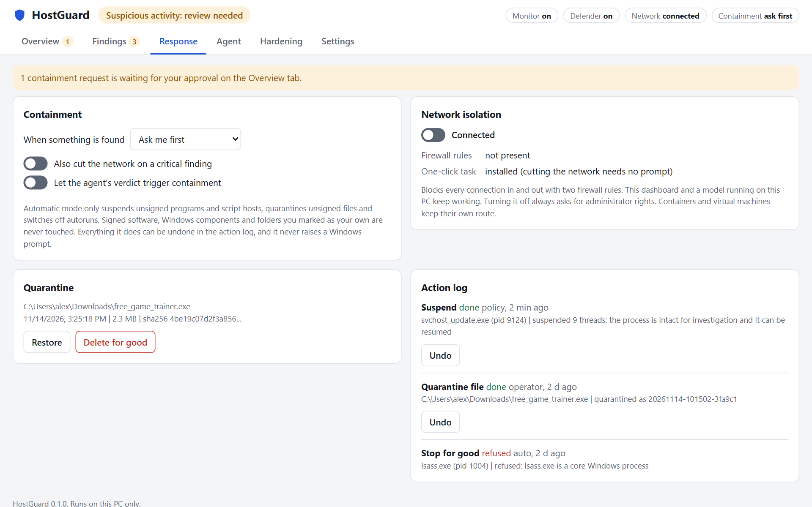

#  HostGuard

[](https://github.com/Cobez02/hostguard/actions/workflows/tests.yml)

An agentic detection-and-response layer for one Windows PC. Free, local, standard library only.

Microsoft Defender stays the antivirus engine: it is already installed, it scores with the paid
consumer products in independent tests, and nothing open source replaces its real-time protection
on Windows. What a home PC lacks is the layer above the engine, which Microsoft sells as Defender
for Endpoint: an answer to "am I compromised?", visibility into what starts by itself and what
ran, containment, and someone to investigate. HostGuard is that layer.



*The pictures show the demo (`python tools/demo.py`), which serves the dashboard with invented data.*

**Status: early.** Built in November 2026 and used on one Windows 11 PC so far. Read
[Limits](#limits) before relying on it.

## Install

Windows 10 or 11 and Python 3.11 or newer. HostGuard has no dependencies and downloads nothing.

```
pip install git+https://github.com/Cobez02/hostguard
hostguard shortcuts add       # Desktop and Start Menu shortcuts that open the dashboard
hostguard ui                  # or open the dashboard from a terminal
hostguard scan                # about a minute: is anything wrong?
```

Or run it from a clone, without installing anything:

```
git clone https://github.com/Cobez02/hostguard
cd hostguard
python run.py ui
```

`hostguard <command>` and `python run.py <command>` are the same thing. If pip warns that its
Scripts folder is not on PATH, `python -m hostguard <command>` works from anywhere.

## What it adds to Defender

HostGuard does not catch more malware than Defender. It answers the questions Defender leaves open.

| | Defender on a home PC | With HostGuard |
|---|---|---|
| Known malicious files | Blocked | Unchanged: Defender still does this |
| "Am I compromised?" | No answer | One verdict from processes, autoruns, accounts, certificates, listeners, logs and memory |
| What changed since last week | Not tracked | New autoruns, accounts, administrators, listening ports, root certificates and extensions are flagged |
| Response | Quarantines what it recognises | Suspend, quarantine, switch off an autorun, block an address or isolate the PC, with an Undo |
| Investigation | You and Event Viewer | A local model with read-only tools that shows its evidence |
| Protections that ship turned off | Spread over Group Policy and PowerShell | One page of switches that show Windows' real state |

## What it does

| | |
|---|---|
| **Compromise check** | Running processes (impostors, abused Windows tools, odd parents, unsigned code), network connections and listeners, every autorun location (registry, tasks, services, drivers, WMI subscriptions, COM overrides, startup folders, BITS jobs and about twenty more), Defender's state and history, accounts, trusted root certificates, hosts and proxy settings, browser extensions and policies, the event logs, files in the folders downloads land in, and the memory of your own processes for injected code. |
| **One verdict** | *No signs of compromise*, *items to review*, *suspicious*, or *signs of compromise*. Hardening gaps are listed separately and never raise it. Every scan also says what it could **not** see. |
| **Change tracking** | Accept a baseline once. Later scans flag each new autorun, account, administrator, listening port, root certificate and browser extension. |
| **Containment** | Suspend or stop a process, quarantine a file, switch off an autorun, block an address, cut the PC off the network. Reversible actions have an Undo. Guardrails are code: core Windows processes and files can never be targets. |
| **Automatic containment** | Off, ask first (default), or automatic. Automatic only touches unsigned programs and script hosts, only with reversible actions, never raises a UAC prompt, and stops at an hourly limit. |
| **Real-time monitor** | Watches new processes, connections, autoruns, downloads and log events, runs the same rules, applies the policy and raises a Windows notification. |
| **Triage agent** | A language model investigates a finding with 15 read-only tools and reports a verdict with its evidence. It runs on a local model through Ollama by default, so it costs nothing and nothing leaves the PC. |
| **Hardening** | The free Windows protections that are off by default (attack surface reduction rules, unwanted-app blocking, ransomware folder protection, command-line and script logging, Sysmon), as switches that show Windows' real state. |
| **Dashboard** | All of the above as one local web page: the verdict, findings with their evidence, approvals, switches and logs. |

## Why it is built this way

- **The model advises, code decides.** The agent has no tool that changes anything. A "malicious"
  verdict queues a request for you. A "benign" verdict closes nothing and cancels nothing, because
  the text the model reads comes from a machine that may be compromised and that text must not be
  able to talk HostGuard out of containing something. A unit test pins this.
- **Read back, never assume.** A switch shows what Windows reports. A suspension is confirmed from
  the thread suspend counts, isolation from the firewall rules, a quarantine from the file being
  gone.
- **Unprivileged by default.** HostGuard runs as you. The few things that need administrator
  rights go through one small PowerShell script, one request per UAC prompt, and that script
  re-checks its own arguments.
- **Unprivileged code can tighten, only you can loosen.** The optional one-click isolation task
  can cut the network without a prompt. Restoring it always needs your approval.
- **Unknown is not guilty.** A file whose signature could not be read is left alone; only a file
  that was checked and found unsigned counts as unsigned.

## The dashboard


```
hostguard ui                # open it, starting it first if it is not running
hostguard ui stop
hostguard ui status
hostguard ui run            # serve in this window instead, until Ctrl+C
hostguard shortcuts add     # Desktop and Start Menu shortcuts; `shortcuts remove` takes them away
```

A shortcut runs HostGuard without a console window and opens the dashboard in your default
browser. If that fails, a message box says why.

It runs as its own windowless process at `http://127.0.0.1:8930/` and keeps running until you
stop it from its Settings tab or with `ui stop`. `--port` picks another port. The launcher checks
that a browser really signed in. If none did, it prints the sign-in link for you to paste.

A local web page is a real attack surface: any site you visit can make your browser send requests
to a local port. So the dashboard is built to refuse everything that is not its own page.

- **This PC only.** It binds `127.0.0.1`, holds the port exclusively, and answers only requests
  whose `Host` is exactly that address, which defeats DNS rebinding.
- **Sign-in links work once.** The launcher reads a random key from a file in your profile and
  opens `/login?k=...`. Using the key replaces it, so the copy left in the browser's history or on
  the browser's command line is dead. Before it sends a key anywhere, the launcher makes the
  listener prove it is the process that wrote the key file.
- **No ambient authority.** The session cookie is `HttpOnly` and `SameSite=Strict`. Every data
  request must also carry a custom header and a matching `Origin`, and `Sec-Fetch-Site` must say
  same-origin. A forged request from another site fails all of these.
- **Nothing from the PC becomes code.** The page loads nothing from anywhere else, and a
  Content-Security-Policy with a fresh nonce per response forbids inline handlers and styles. File
  names, command lines and model output are only ever placed on the page as text.

It does not protect against a program already running as you. That program can read the key file.

| Response | Hardening |
|---|---|
|  |  |

## Commands

```
ui [open|start|run|stop|status] [--port N] [--no-browser]   the dashboard
app | shortcuts add|remove|status       what a shortcut runs; create or remove the shortcuts
scan [--profile quick|full|deep] [--detail] [--policy]   look for signs of compromise
elevated-scan                    same, plus what only an administrator can read (one UAC prompt)
status | findings | show ID      what is open
allow ID | resolve ID | reopen ID
baseline accept|status
contain ACTION --finding ID [--dry-run]     suspend kill quarantine disable_autorun block_ip ...
undo ACTION_ID | actions [pending|approve N|deny N]
quarantine list|restore ID|delete ID
isolate on|off|status
monitor start|stop|status|run
triage [ID] | ask "question"     the agent
harden status|apply NAME|revert NAME
components | selftest [--defender] | report | config | reset
```

Scan exit codes: 0 clean or review, 1 suspicious, 2 signs of compromise.

## Settings

`~/.hostguard/config.json`, the dashboard, or `hostguard config set containment.mode auto`.

| Setting | Default | Meaning |
|---|---|---|
| `containment.mode` | `ask` | `off` report only, `ask` queue for approval, `auto` act |
| `containment.auto_min_severity` / `auto_min_confidence` | `critical` / `high` | what automatic mode acts on |
| `containment.process_action` | `suspend` | `suspend`, `kill` or `none` |
| `containment.isolate_on_critical` | `false` | also cut the network |
| `containment.agent_can_escalate` | `false` | let a "malicious" verdict trigger the policy |
| `containment.max_auto_actions_per_hour` | `10` | beyond this, automatic becomes ask |
| `trusted.paths` | `[]` | your own security tooling: findings inside are marked down and never auto-contained |
| `agent.endpoint` / `agent.model` | Ollama on this PC / automatic | any OpenAI-compatible endpoint works |
| `agent.online_lookups` | `false` | let the agent send a file's SHA-256 to CIRCL hashlookup |
| `monitor.notify` | `true` | Windows notifications from the monitor |

## Optional open-source add-ons

HostGuard downloads nothing. Put a tool in `~/.hostguard/tools/<name>/` and scans use it.
`hostguard components` and the dashboard's Hardening tab show where each goes.

| Add-on | Adds |
|---|---|
| [YARA](https://github.com/VirusTotal/yara/releases) with the [YARA Forge](https://github.com/YARAHQ/yara-forge/releases) core pack | Signature matching over Downloads, Desktop, Temp and Public |
| [Hollows Hunter](https://github.com/hasherezade/hollows_hunter/releases) | A deep scan of every process for implanted or replaced code |
| [Hayabusa](https://github.com/Yamato-Security/hayabusa/releases) | Thousands of Sigma rules over the event logs, during the administrator scan |
| Sysmon (built into recent Windows 11) | Full process, network and injection telemetry, from the Hardening switch |

The command lines follow each project's documentation as of November 2026. They were tested here
against stand-in executables, **not** against the real tools.
See [docs/open-source-review.md](docs/open-source-review.md) for the full survey and why this was
built rather than adopted.

## Limits

Read these before relying on it.

- **It cannot defend itself.** HostGuard is ordinary user-mode code. Malware already running as
  you, and written to look for it, can stop the monitor, edit its settings or sign in to its
  dashboard. Defender's Tamper Protection is the tamper-resistant layer; HostGuard checks that it
  is on.
- **Polling misses short-lived processes.** Without administrator rights the monitor sees a new
  process only if it lives long enough to be polled. Turn on command-line auditing or Sysmon under
  Hardening to close that gap: the monitor reads those logs too.
- **An unelevated scan is partial.** System processes cannot be opened, the Security log cannot be
  read and Defender hides its exclusion list. The scan says so each time. Use the administrator scan.
- **The memory check covers your own processes**, and games with anti-tamper protection trip it
  legitimately (reported as low when the program is signed).
- **Isolation covers this PC's own programs.** Containers and virtual machines route separately.
- **A local model can be wrong.** Its verdict is shown with its evidence so you can check it.
- **Not live-tested:** everything that needs a UAC prompt (isolation, address blocking, the
  hardening switches, the administrator scan, elevated quarantine). Those paths are covered by
  dry-run tests that prove each request is validated and what it would change, not that Windows
  accepts the change.

## Microsoft Store Python

If Python came from the Microsoft Store, Windows gives it a private copy of any new file it
creates under AppData. HostGuard keeps its state in `~/.hostguard` for that reason, and restores
quarantined files into AppData through Windows' transfer service so they land in the real folder.

## Tests

```
python -m unittest discover -s tests
```

198 tests. They cover the rules (what must fire and what must not), they exercise containment
for real on throwaway processes, files and registry values that the tests create themselves, and
they send the dashboard the requests a hostile web page could forge and check each is refused.
Every push installs the package with pip on GitHub's Windows machines and runs the suite there
with Python 3.11 and 3.13.

## Layout

```
run.py                  entry point from a clone (installed: the `hostguard` command)
pyproject.toml          packaging: no dependencies, two commands
hostguard/
  collect/              gathers facts, judges nothing
  detect/               rules: facts in, findings out
  scan.py               one scan: collect, judge, record
  contain.py policy.py  actions with guardrails; when to act
  quarantine.py         the vault
  monitor.py notify.py  the real-time loop and notifications
  agent.py tools.py     the triage agent and its read-only tools
  elevate.py harden.py  the administrator path and the hardening switches
  components.py         optional add-ons
  ui.py page.py api.py  the dashboard: server, page, and the requests behind it
  launch.py shortcuts.py  how background processes and shortcuts start HostGuard
  ps/                   PowerShell: collectors, the elevated helper
  assets/               the icon
tools/                  demo.py (the dashboard with invented data), make_icon.py
tests/  docs/
```

MIT licence.
