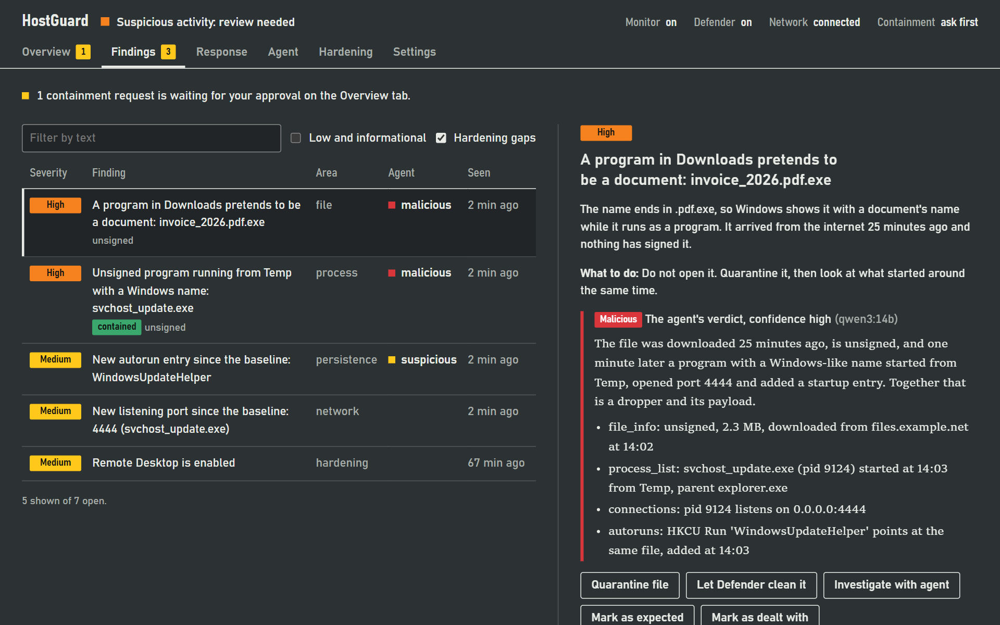
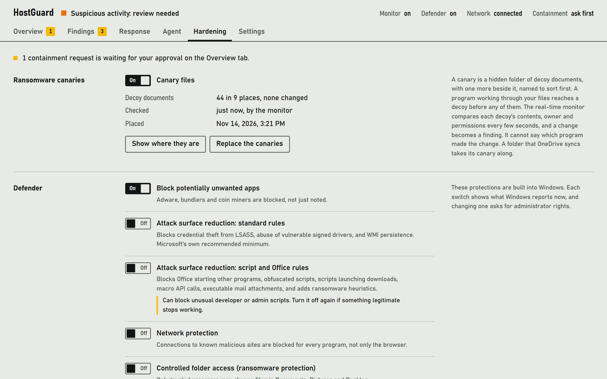

#  HostGuard

[](https://github.com/Cobez02/hostguard/actions/workflows/tests.yml)

An agentic detection-and-response layer for one Windows PC. Free, local, standard library only.

Microsoft Defender stays the antivirus engine: it is already installed, it scores with the paid
consumer products in independent tests, and nothing open source replaces its real-time protection
on Windows. What a home PC lacks is the layer above the engine, which Microsoft sells as Defender
for Endpoint: an answer to "am I compromised?", visibility into what starts by itself and what
ran, containment, and someone to investigate. HostGuard is that layer.


*The pictures show the demo (`python tools/demo.py`), which serves the dashboard with invented data.*

**Status: early.** Built in November 2026 and used on one Windows 11 PC so far. Read
[Limits](#limits) before relying on it.

## Install

Windows 10 or 11 and Python 3.11 or newer. HostGuard has no dependencies. It downloads nothing
unless you press Download for an optional add-on.

```
pip install git+https://github.com/Cobez02/hostguard
hostguard shortcuts add       # Desktop and Start Menu shortcuts that open the dashboard
hostguard ui                  # or open the dashboard from a terminal
hostguard scan                # about a minute: is anything wrong?
```

Or run it from a clone, without installing anything:

```
git clone https://github.com/Cobez02/hostguard
cd hostguard
python run.py ui
```

`hostguard <command>` and `python run.py <command>` are the same thing. If pip warns that its
Scripts folder is not on PATH, `python -m hostguard <command>` works from anywhere.

## What it adds to Defender

HostGuard does not catch more malware than Defender. It answers the questions Defender leaves open.

| | Defender on a home PC | With HostGuard |
|---|---|---|
| Known malicious files | Blocked | Unchanged: Defender still does this |
| "Am I compromised?" | No answer | One verdict from processes, autoruns, accounts, certificates, listeners, logs and memory |
| What changed since last week | Not tracked | New autoruns, accounts, administrators, listening ports, root certificates and extensions are flagged |
| A program rewriting your files | Controlled folder access, which ships turned off | Hidden decoy documents that raise the alarm when one is rewritten, whatever the program |
| Response | Quarantines what it recognises | Suspend, quarantine, switch off an autorun, block an address or isolate the PC, with an Undo |
| Investigation | You and Event Viewer | A local model with read-only tools that shows its evidence |
| Protections that ship turned off | Spread over Group Policy and PowerShell | One page of switches that show Windows' real state |

## What it does

| | |
|---|---|
| **Compromise check** | Running processes (impostors, abused Windows tools, odd parents, unsigned code), network connections and listeners, every autorun location (registry, tasks, services, drivers, WMI subscriptions, COM overrides, startup folders, BITS jobs and about twenty more), Defender's state and history, accounts, trusted root certificates, hosts and proxy settings, browser extensions and policies, the event logs, files in the folders downloads land in, and the memory of your own processes for injected code. |
| **One verdict** | *No signs of compromise*, *items to review*, *suspicious*, or *signs of compromise*. Hardening gaps are listed separately and never raise it. Every scan also says what it could **not** see. |
| **Change tracking** | Accept a baseline once. Later scans flag each new autorun, account, administrator, listening port, root certificate and browser extension. A new autorun is graded by what it starts, so a signed program updating itself is listed without changing the verdict. |
| **Containment** | Suspend or stop a process, quarantine a file, switch off an autorun, block an address, cut the PC off the network. Reversible actions have an Undo. Guardrails are code: core Windows processes and files can never be targets. |
| **Automatic containment** | Off, ask first (default), or automatic. Automatic only touches unsigned programs and script hosts, only with reversible actions, never raises a UAC prompt, and stops at an hourly limit. |
| **Real-time monitor** | Watches new processes, connections, autoruns, downloads, log events and Defender's own state, and the canaries if you placed them. It runs the same rules, applies the policy and raises a Windows notification. |
| **Ransomware canaries** | Optional. Hidden decoy documents where a walk of your folders starts. The monitor compares their contents, owner and permissions every few seconds, and a decoy that is no longer a document is a critical finding. See [Ransomware canaries](#ransomware-canaries). |
| **Triage agent** | A language model investigates a finding with 15 read-only tools and reports a verdict with its evidence. It runs on a local model through Ollama by default, so it costs nothing and nothing leaves the PC. |
| **Hardening** | The free Windows protections that are off by default (attack surface reduction rules, unwanted-app blocking, ransomware folder protection, command-line and script logging, Sysmon), as switches that show Windows' real state. A switch you flipped can be put back from the action log. |
| **Dashboard** | All of the above as one local web page: the verdict, findings with their evidence, approvals, switches and logs. |

## Why it is built this way

- **The model advises, code decides.** The agent has no tool that changes anything. A "malicious"
  verdict queues a request for you. A "benign" verdict closes nothing and cancels nothing, because
  the text the model reads comes from a machine that may be compromised and that text must not be
  able to talk HostGuard out of containing something. A unit test pins this.
- **Read back, never assume.** A switch shows what Windows reports. A suspension is confirmed from
  the thread suspend counts, isolation from the firewall rules, a quarantine from the file being
  gone.
- **Unprivileged by default.** HostGuard runs as you. The few things that need administrator
  rights go through one small PowerShell script, one request per UAC prompt, and that script
  re-checks its own arguments.
- **Unprivileged code can tighten, only you can loosen.** The optional one-click isolation task
  can cut the network without a prompt. Restoring it always needs your approval.
- **Unknown is not guilty.** A file whose signature could not be read is left alone; only a file
  that was checked and found unsigned counts as unsigned.

## The dashboard



```
hostguard ui                # open it, starting it first if it is not running
hostguard ui stop
hostguard ui status
hostguard ui run            # serve in this window instead, until Ctrl+C
hostguard shortcuts add     # Desktop and Start Menu shortcuts; `shortcuts remove` takes them away
```

A shortcut runs HostGuard without a console window and opens the dashboard in your default
browser. If that fails, a message box says why.

It runs as its own windowless process at `http://127.0.0.1:8930/` and keeps running until you
stop it from its Settings tab or with `ui stop`. `--port` picks another port. The launcher checks
that a browser really signed in. If none did, it prints the sign-in link for you to paste.

A local web page is a real attack surface: any site you visit can make your browser send requests
to a local port. So the dashboard is built to refuse everything that is not its own page.

- **This PC only.** It binds `127.0.0.1`, holds the port exclusively, and answers only requests
  whose `Host` is exactly that address, which defeats DNS rebinding.
- **Sign-in links work once.** The launcher reads a random key from a file in your profile and
  opens `/login?k=...`. Using the key replaces it, so the copy left in the browser's history or on
  the browser's command line is dead. Before it sends a key anywhere, the launcher makes the
  listener prove it is the process that wrote the key file.
- **No ambient authority.** The session cookie is `HttpOnly` and `SameSite=Strict`. Every data
  request must also carry a custom header and a matching `Origin`, and `Sec-Fetch-Site` must say
  same-origin. A forged request from another site fails all of these.
- **Nothing from the PC becomes code.** The page loads nothing from anywhere else, and a
  Content-Security-Policy with a fresh nonce per response forbids inline handlers and styles. File
  names, command lines and model output are only ever placed on the page as text.

It does not protect against a program already running as you. That program can read the key file.

| Response | Hardening |
|---|---|
|  |  |

## Commands

```
ui [open|start|run|stop|status] [--port N] [--no-browser]   the dashboard
app | shortcuts add|remove|status       what a shortcut runs; create or remove the shortcuts
scan [--profile quick|full|deep] [--detail] [--policy]   look for signs of compromise
elevated-scan                    same, plus what only an administrator can read (one UAC prompt)
status | findings | show ID      what is open
allow ID | resolve ID | reopen ID
baseline accept|status
contain ACTION --finding ID [--dry-run]     suspend kill quarantine disable_autorun block_ip ...
contain ACTION pid=N | path=FILE | ip=ADDRESS   the same, on something you name yourself
undo ACTION_ID | actions [pending|approve N|deny N]
quarantine list|restore ID|delete ID --yes
isolate on|off|status
monitor start|stop|status|run
canary [status|on|off|replace]   ransomware canaries: place them, read their state, take them away
triage [ID] | ask "question"     the agent
harden status|apply NAME|revert NAME
components [install|remove NAME] | selftest [--defender] | report
config [set KEY VALUE] | reset --yes
```

The commands that list or show something take `--json`.

Exit codes: `scan` ends with 0 for clean or review, 1 for suspicious and 2 for signs of compromise.
`canary status` ends with 1 while a canary finding of high or critical severity stands.

## Settings

`~/.hostguard/config.json`, the dashboard, or `hostguard config set containment.mode auto`.
`hostguard config` prints every setting. The table has the ones you are most likely to change.

| Setting | Default | Meaning |
|---|---|---|
| `containment.mode` | `ask` | `off` report only, `ask` queue for approval, `auto` act |
| `containment.auto_min_severity` / `auto_min_confidence` | `critical` / `high` | what automatic mode acts on |
| `containment.process_action` | `suspend` | `suspend`, `kill` or `none` |
| `containment.isolate_on_critical` | `false` | also cut the network |
| `containment.agent_can_escalate` | `false` | let a "malicious" verdict trigger the policy |
| `containment.max_auto_actions_per_hour` | `10` | beyond this, automatic becomes ask |
| `trusted.paths` | `[]` | your own security tooling: findings inside are marked down and never auto-contained |
| `agent.endpoint` / `agent.model` | Ollama on this PC / automatic | any OpenAI-compatible endpoint works |
| `agent.online_lookups` | `false` | let the agent send a file's SHA-256 to CIRCL hashlookup |
| `monitor.notify` | `true` | Windows notifications from the monitor |
| `monitor.canary_interval_s` | `3` | how often the monitor looks at the canaries |
| `canary.drive_roots` / `canary.extra_dirs` | `true` / `[]` | a canary at the top of each fixed drive; more folders of yours to put one in. Used the next time the canaries are placed |

## Ransomware canaries

Off until you turn on **Canary files** on the Hardening tab, or run `hostguard canary on`.

Ransomware works through the disk and rewrites every document it reaches. A canary is a hidden
folder of four decoy documents with one more hidden decoy beside it. Their names start with `!`,
which sorts first, so a program working through a folder meets a decoy before a real file, whether
it takes the folder's own files first or goes into the subfolders first. Each decoy is a real
Word, Excel, PDF or PNG file, different on every PC, and the three documents say inside what they
are.

One canary goes into your profile folder, into Desktop, Documents, Pictures, Downloads, Music and
Videos wherever Windows really keeps them, into Public Documents, and at the top of each fixed
drive. The switch lists the places before it creates anything, and a place Windows will not let
HostGuard write to is skipped. At the top of the system drive Windows allows a new folder but not
a new file, so that canary is the folder alone.

HostGuard records each decoy's contents, owner and permissions from the disk when it places it.
The monitor looks every three seconds. Each time it compares owner and permissions, and it reads a
decoy again if its size or time has moved. Every half minute it reads all of them again, which
catches a rewrite that put both back. Every scan compares them too.

| What happened to a decoy | Finding |
|---|---|
| It is no longer a document at all, it was swapped for another file, or a ransom note sits beside it | critical, `canary.ransomware` |
| It was deleted and nothing was left in its place | high, `canary.destroyed` |
| Its owner changed, a permission was added to it or taken off it, Windows' own file encryption was switched on for it, or HostGuard was locked out of it | high, `canary.permissions` |
| It was edited and is still a sound document, or an ordinary new file sits beside it | medium, `canary.edited` |
| Only a permission handed down from the folder above changed, or a mark such as Read-only | low, `canary.settings` |

There is one canary finding at a time, named for the strongest thing seen. Two of the comparisons
behind it are checked, not guessed:

- **Still a sound document.** Word, Excel and PNG files carry checksums that encryption breaks,
  and a PDF loses its header or the table of its parts. So an editor or a sync service saving a
  decoy is told apart from something overwriting it.
- **Who may do what.** Permissions are compared by what they grant, not by how Windows stores
  them. A tool that rewrites a file's access list and leaves the same accounts with the same
  rights raises nothing.

A folder that is not there, such as an unplugged drive, and a decoy that another program has open
are reported as not checked, never as changed. HostGuard's own list of its canaries is watched as
well: overwriting it is a finding, and a running monitor carries on from the copy it remembers.

A canary says that something is rewriting files. It cannot say which program. When the critical
finding is raised, HostGuard reads Windows' own counters twice, a second apart, and lists the
programs that wrote most in between as evidence. One that is unsigned, or is one of Windows'
script hosts, becomes a finding of its own with a request to suspend it. That is a lead and is
worded as one: the counters cover everything a program writes, to disk, pipes and the network.

Marking the finding as dealt with holds until something else changes. `hostguard canary replace`,
or **Replace the canaries**, puts a fresh set down under a new name and closes it. Turning the
canaries off deletes only the decoys that are still exactly what was placed. One that was changed
stays where it is.

## Optional open-source add-ons

HostGuard works without them and fetches nothing by itself. Each add-on has a Download button on
the dashboard's Hardening tab, and `hostguard components install yara` does the same from a
terminal. You can also put a tool in `~/.hostguard/tools/<name>/` by hand.

| Add-on | Adds | Pinned release |
|---|---|---|
| [YARA](https://github.com/VirusTotal/yara/releases) with the [YARA Forge](https://github.com/YARAHQ/yara-forge/releases) core pack | Signature matching over the files each scan singles out. A deep scan also sweeps the download folders | 4.6.0, rules of 2026-11-15 |
| [Hollows Hunter](https://github.com/hasherezade/hollows_hunter/releases) | In a deep scan, a check of every process for implanted or replaced code | 0.4.1.1 |
| [Hayabusa](https://github.com/Yamato-Security/hayabusa/releases) | Thousands of Sigma rules over the event logs, during the administrator scan | 4.4.0 |
| Sysmon (built into recent Windows 11) | Full process, network and injection telemetry | A Windows feature: use the Hardening switch |

A download is narrow on purpose. It can fetch only the files pinned in `hostguard/addons.py`: a
fixed github.com release address with the size and SHA-256 that the project's release page
published. A file that does not match is thrown away before anything is unpacked, redirects are
followed only to GitHub's own download hosts, and an archive cannot write outside its add-on's
folder. Nothing downloaded is run at that point: later scans use it.

The command lines follow each project's documentation as of November 2026. The automated tests use
stand-in executables and a stand-in release server. On one Windows 11 PC the three downloads were
also done for real, and YARA 4.6.0 and Hollows Hunter 0.4.1.1 were run for real. Hayabusa has not
been run yet.
See [docs/open-source-review.md](docs/open-source-review.md) for the full survey and why this was
built rather than adopted.

## Limits

Read these before relying on it.

- **It cannot defend itself.** HostGuard is ordinary user-mode code. Malware already running as
  you, and written to look for it, can stop the monitor, edit its settings or sign in to its
  dashboard. Defender's Tamper Protection is the tamper-resistant layer; HostGuard checks that it
  is on.
- **Polling misses short-lived processes.** Without administrator rights the monitor sees a new
  process only if it lives long enough to be polled. Turn on command-line auditing or Sysmon under
  Hardening to close that gap: the monitor reads those logs too.
- **An unelevated scan is partial.** System processes cannot be opened, the Security log cannot be
  read and Defender hides its exclusion list. The scan says so each time. Use the administrator scan.
- **The memory check covers your own processes**, and games with anti-tamper protection trip it
  legitimately (reported as low when the program is signed).
- **Isolation covers this PC's own programs.** Containers and virtual machines route separately.
- **Canaries are a tripwire, not a wall.** They are checked every three seconds, not at the moment
  of the write, and nothing is stopped unless you approve the request. Automatic containment acts
  on it only if you lower its thresholds to high severity and medium confidence, and only when one
  unsigned program or script host is clearly writing the most. A program that starts in a folder
  without a canary, or that skips hidden files, reaches your files first. A folder that OneDrive
  syncs takes its canary along. They have been tripped by a stand-in that rewrites and renames
  files in a throwaway folder, where the alarm came 1.3 seconds after the first file, and never by
  real ransomware.
- **A local model can be wrong.** Its verdict is shown with its evidence so you can check it.
- **Not live-tested:** network isolation, address blocking, elevated quarantine, undoing a
  hardening switch from the action log, and running Hayabusa. Those paths are covered by dry-run
  and stand-in tests that prove each request is validated and what it would change, not that
  Windows accepts it. The administrator scan, the add-on downloads and eight of the hardening
  switches have been used for real on one Windows 11 PC. The canaries have been placed in
  throwaway folders only.

## Microsoft Store Python

If Python came from the Microsoft Store, Windows gives it a private copy of any new file it
creates under AppData. HostGuard keeps its state in `~/.hostguard` for that reason, and restores
quarantined files into AppData through Windows' transfer service so they land in the real folder.

## Tests

```
python -m unittest discover -s tests
```

287 tests. They cover the rules (what must fire and what must not), they exercise containment
for real on throwaway processes, files and registry values that the tests create themselves,
they place canaries in throwaway folders and overwrite, rename, delete, lock and re-permission them,
they send the dashboard the requests a hostile web page could forge and check each is refused,
and they feed the add-on downloader altered files, hostile archives and foreign addresses.
Every push installs the package with pip on GitHub's Windows machines and runs the suite there
with Python 3.11 and 3.13.

## Layout

```
run.py                  entry point from a clone (installed: the `hostguard` command)
pyproject.toml          packaging: no dependencies, two commands
hostguard/
  collect/              gathers facts, judges nothing
  detect/               rules: facts in, findings out
  scan.py               one scan: collect, judge, record
  contain.py policy.py  actions with guardrails; when to act
  quarantine.py         the vault
  canary.py             ransomware canaries: placing, removing and checking the decoys
  monitor.py notify.py  the real-time loop and notifications
  agent.py tools.py     the triage agent and its read-only tools
  elevate.py harden.py  the administrator path and the hardening switches
  components.py addons.py  optional add-ons: running them, and downloading pinned releases
  ui.py page.py api.py  the dashboard: server, page, and the requests behind it
  launch.py shortcuts.py  how background processes and shortcuts start HostGuard
  cli.py store.py model.py  the commands, the SQLite state, what a finding is
  defender.py report.py selftest.py  Defender's scanner, reports, the self-test
  winapi.py sigs.py reg.py  Windows calls, signature checks, registry reads
  util.py paths.py pe.py lnk.py  helpers, settings and state folder, readers for programs and shortcuts
  ps/                   PowerShell: collectors, the elevated helper
  assets/               the icon
tools/                  demo.py (the dashboard with invented data), make_icon.py
tests/  docs/
```

MIT licence.
